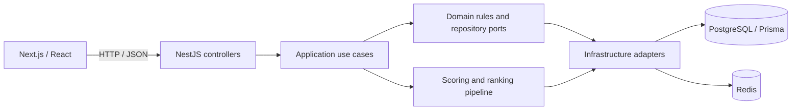

# EERS full-stack portfolio

EERS helps customers compare businesses using multi-criteria reviews and helps owners understand and respond to feedback. Its main engineering discussion point is how a review becomes a transparent ranking, across a typed web client, an authenticated API, persistent data, and a cache.

## Architecture walkthrough



The browser uses TanStack Query for server state. The API client attaches an in-memory access token and sends cookies for refresh requests. NestJS validates request DTOs, wraps successful responses, and translates exceptions into a common error shape. Use cases depend on repository contracts; Prisma and Redis adapters implement persistence and caching.

Useful code to discuss in an interview:

| Topic | Implementation | Discussion |
| --- | --- | --- |
| Browser authentication | [API client](../apps/web/app/lib/api-client.ts) | In-memory access token, refresh requests, and browser cookies |
| HTTP boundary | [Shared HTTP configuration](../apps/api/src/configure-http-app.ts) | Validation, CORS, security headers, and response contracts |
| Authentication behavior | [HTTP contract tests](../apps/api/test/app.e2e-spec.ts) | Exercise real routes and middleware with mocked use cases |
| Ranking | [Application services](../apps/api/src/modules/ranking/application/services) | Criterion scores, review weighting, trust signals, and score adjustment |
| Persistence | [Prisma schema](../apps/api/prisma/schema.prisma) | Relations, constraints, and migration strategy |
| Automation | [CI workflow](../.github/workflows/ci.yml) | Tests, builds, frontend checks, and Docker image builds |

## Five-minute demo

1. **Discovery:** filter the business directory by category and location, then open a profile. Explain the frontend query and API response.
2. **Reviews:** show criterion scores and owner replies. Register a new demo customer to submit a review; seeded customers have already reviewed the original businesses.
3. **Rankings:** compare two businesses and explain why a ranking is more than a raw star average. Point to the scoring tests rather than claiming the algorithm is proven unbiased.
4. **Owner workflow:** sign in with the owner account from the README, inspect the dashboard, and demonstrate replying to feedback.
5. **Engineering evidence:** show API docs, the architecture above, and a successful local check or an actual completed CI run.

Use fictional demo data. Explain that seeded sentiment labels are authored data and do not measure model accuracy. Do not claim historical ranking data beyond the snapshots actually recorded.

## Reproducible checks

Run from the repository root after installing dependencies and generating the Prisma client:

```sh
pnpm portfolio:check
```

This checks frontend TypeScript, compiles the API, runs backend unit tests, and runs authentication HTTP integration tests. It does not require a running database. The HTTP tests cover validation, rejection of unexpected privilege fields, login response and cookie behavior, domain errors, refresh cookie parsing, logout, and route prefixes. Their application use cases are mocked: they do not establish database correctness or a complete browser login flow.

CI additionally runs frontend lint, the Next.js production build, and Docker image builds. Local `portfolio:check` is intentionally narrower; a passing result does not imply those additional jobs passed. Backend lint is not currently a CI gate because of existing lint debt.

## CV wording

Adapt these bullets to your actual contribution:

- Built a business discovery and review platform using Next.js, NestJS, PostgreSQL, Prisma, and Redis in a TypeScript monorepo, with customer, owner, and administrator workflows.
- Implemented multi-criteria business rankings incorporating reviewer trust, fraud signals, time decay, and Bayesian adjustment, with automated scoring tests.
- Added authentication HTTP contract tests and CI checks for backend tests, frontend validation, production builds, and Docker images.

Only include the second bullet if you implemented or can explain the ranking pipeline. Do not add invented traffic, latency, accuracy, or business-impact metrics. Test counts should come from the current run, not a permanent CV claim.

## Before sharing the CV

- Add a working hosted demo link and repository link to the README once available.
- Capture screenshots of the directory, business detail, ranking page, and owner dashboard with the fictional dataset.
- Record a short demo following the walkthrough above.
- Verify the customer review, owner reply, and administrator moderation flows in a browser against the demo database.
- Add browser automation for those journeys and database integration tests as the next test milestone.
- Measure performance against a documented dataset before making performance claims.

Deployment, browser automation, load testing, and production readiness are separate milestones; this document does not assert they are complete.
